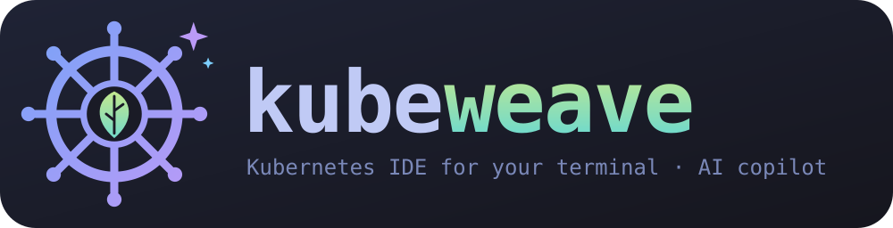

<p align="center">
  
</p>

# kubesage

A Kubernetes IDE for the terminal, in the spirit of k9s and Lens, with an AI copilot that
reads your cluster's manifests, events and logs and tells you what is wrong and how to fix it.

- A single static binary. Runs in bash, zsh, PowerShell and Windows Terminal (macOS, Linux, Windows).
- Colour themes using truecolor, which falls back to 256 or 16 colours automatically.
- Works with local LLMs (Ollama, LM Studio, vLLM) or with API keys for Anthropic Claude, OpenAI, Azure OpenAI and Google Gemini.
- A built-in issue detector that needs no AI, for CrashLoopBackOff, OOMKilled, image pull errors, unschedulable pods, stuck rollouts, node pressure and more.

## Install

```bash
make build        # → bin/kubesage
make install      # → $GOPATH/bin/kubesage
make release      # cross-compile for macOS, Linux, Windows into dist/
```

Requires the Go version listed in `go.mod`. `kubectl` is optional. It is used for `describe`, `edit` and debug containers; shells and port-forwards work without it. Everything else talks to the API directly through client-go.

## Use

```bash
kubesage                          # current context & namespace
kubesage --context my-aks -n shop # pick context / namespace
kubesage -A -r deploy             # all namespaces, open deployments
kubesage --readonly               # disable delete/scale/restart/edit
kubesage scan                     # CI-friendly issue report (exit 2 on errors)
kubesage ask "why is checkout-api not ready?"   # one-shot AI answer to stdout
kubesage config init              # write a starter config
```

### Finding any resource

Press **`0`** (or `:resources`) to open the **resource browser**. It lists every resource type the cluster serves, grouped into:

| Group | Resources |
|---|---|
| Workloads | Pods, Deployments, StatefulSets, DaemonSets, ReplicaSets, Jobs, CronJobs, HPAs, PodDisruptionBudgets |
| Network | Services, Ingresses, Endpoints, NetworkPolicies |
| Config & Storage | ConfigMaps, Secrets, PVCs, PersistentVolumes, StorageClasses |
| Access control (RBAC) | ServiceAccounts, Roles, RoleBindings, ClusterRoles, ClusterRoleBindings (wildcard rules and `cluster-admin` bindings are flagged) |
| Cluster | Events, Nodes, Namespaces |
| Custom resources | every CRD on the cluster (cert-manager Certificates, Datadog, Argo, Istio…), with the CRD's own printer columns and a Ready/phase status |
| Other APIs | any other listable API (e.g. metrics, snapshot, gateway APIs) |

Type to filter (`rolebinding`, `cert`, `datadog`), then press `enter`. Commands work as well: `:rb`, `:crb`, `:sa`, `:netpol`, `:pv`, `:sc`, `:pdb`, `:rs`, `:ds`, `:cm`,
or any CRD name or short name (`:certificates`, `:cert`). `:crd` lists the CustomResourceDefinitions, and `enter` on one opens its objects.
Describe, YAML, edit, delete and AI analysis work on every type. The header's tab row starts with `0 ☰ All`, and you can change the numbered tabs with `favorites:` in the config.

### Screens

| Key | Screen |
|---|---|
| `1`-`9`, `tab` | resource tabs (favorites) |
| `:pods`, `:deploy`, `:sts`, `:ds`, `:rs`, `:jobs`, `:cj`, `:svc`, `:ing`, `:cm`, `:secret`, `:pvc`, `:hpa`, `:ev`, `:nodes`, `:ns` | jump to a resource (`:pods kube-system` or `:pods all`) |
| `V` / `:policy` | **policy & security checks** for every workload, with AI fixes |
| `H` / `:pulse` | **Pulse**: node/pod/deployment health bars, CPU/memory requests vs capacity, detected issues |
| `:helm` | **Helm releases**: values, manifests, history, revision diff, rollback |
| `b` / `:view <name>` | open a **saved view** (`:view save <name>` stores the current tab) |
| `A` / `:ai <question>` | **AI chat** about the cluster |
| `?` | help |

### Multiple panes

The screen splits into as many as 6 panes, in the style of tmux or vim. Each pane has its own resource, namespace, filter, cursor, YAML/describe view or live logs,
and all of them refresh together. The focused pane has a thick accent border, and the header shows the panes, e.g. `▦ [1:Pods] 2:Events 3:AI`.

| Key / command | Action |
|---|---|
| `\|`  `:vsplit [resource]` | split side by side (e.g. `:vsplit events`, `:vsplit ai`, `:vsplit pulse`) |
| `-`  `:split [resource]` | split stacked |
| `L` | open the selected pod's (or workload's) **logs in a new pane** next to the table |
| `ctrl+w` / `alt+1`…`alt+6` | focus the next pane / pane N |
| `z`  `:zoom` | zoom the focused pane to full screen and back |
| `[`  `]` | shrink / grow the focused pane |
| `ctrl+x`  `:close` / `:only` | close this pane / keep only this pane |
| `n`  `:ns <ns>` / `:ns! <ns>` | namespace of the focused pane / of every pane |
| `:layout <name>` | presets: `triage` (pods \| events / AI), `ops` (deployments / pods \| events), `dash` (pulse \| events), `ai` (table \| AI), `single` |

There is one AI conversation, shown in whichever pane is in AI mode. Pressing `a` on a row in another pane sends the analysis to that AI pane, and the table stays where it is.

### Actions on the selected row

| Key | Action |
|---|---|
| `enter` / `d` | describe (`enter` on a namespace switches to it) |
| `y` | YAML (secrets are masked; `x` unmasks after confirmation) |
| `h` | **pod health report** (usage vs limits, probes, restarts, conditions, advice) |
| `l` / `p` | live logs / previous (crashed) container logs, with container and pod pickers |
| `s` | **shell into a container**: full TTY with resize, bash → ash → sh, no kubectl needed, debug-container fallback for distroless images |
| `a` | **AI analyze**: sends the manifest, events, detected issues and recent and previous logs to the model |
| `e` | **safe edit**: your editor → diff → server dry-run → apply on request |
| `o` | **rollout history** of a deployment: diff revisions, `U` to roll back |
| `S` / `R` / `D` | scale, rollout restart, delete |
| `f` | list port-forwards: open, go to, stop |
| `F` | **port-forward** a pod, service, deployment, statefulset or daemonset (services resolve named target ports to a ready pod) |
| `!` | type and run any `kubectl` command on the current context; the output opens in the viewer |
| `/` | filter, `n` namespace picker, `c` context picker, `T` cycle theme |

### Pod health

- With metrics-server installed, the **pods table shows live `CPU` and `MEM`**, plus the % of the limit when one is set (e.g. `822Mi 55%`).
  Pods at ≥ 90% of a limit turn yellow. The columns are left out when metrics are unavailable or not allowed.
- **`h`** on a pod opens its **health report**, which refreshes every few seconds. On a deployment, statefulset, daemonset or job, `h` first lets you pick a pod. The report shows:
  - a verdict: ✓ Healthy, ▲ Degraded or ✗ Unhealthy, with the reason;
  - status, phase, QoS class, node, IP, age, and every pod condition with how long it has held;
  - per container: state, readiness, restarts and the last exit reason (e.g. `OOMKilled (exit 137) 2h ago`), and the image;
  - CPU and memory bars: live usage against the limit, or against the request when there is no limit, with requests and limits;
  - liveness, readiness and startup probes (type, port, path, timings);
  - advice: no memory limit, no requests (BestEffort), missing probes, close to OOM, CPU throttling;
  - detected issues with hints, and the latest warning events.
  From the report, `a` asks the AI about this pod and `l` opens its logs.

### Secrets

`enter` (or `x`) on a Secret opens the **secret viewer**:
- **Masked by default.** You see each key's name, size and type (text, JSON, PEM certificate or key, binary). For certificates it also shows the subject, DNS names and **expiry**, which is flagged when it is under 30 days away or already past.
- **`x` unmasks** after a confirmation. On production-like contexts you have to type the secret's name. Values are decoded from base64 locally, JSON is pretty-printed and binary values are shown as hex.
- Values **mask again automatically after 60 seconds**, when you press `x`, or when you leave the viewer, and the decoded copy is dropped from memory.
- Decoded values are never written to disk and never sent to the AI. AI analysis always uses the redacted manifest.
- `y` (YAML) uses the same `x` unmask with confirmation.

In the Pulse screen, `enter` analyzes the selected issue and `t` asks the AI to triage every issue at once.

### Shell into a pod

Press **`s`** on a pod, or on a deployment, statefulset or daemonset (you pick the pod), or inside a pod's logs or health view.
With more than one container you pick one; init containers are left out because they have already exited.

- The app hands the terminal over to a full interactive shell, with colours, tab completion and window resizing, and the IDE comes back when you `exit` or press Ctrl-D.
  A banner shows the pod, the container and the cluster you are in.
- It picks the best shell in the image: `bash`, then `ash`, then `sh`.
- kubesage connects to the API itself, so **kubectl is not needed**, and it works the same in bash, zsh, PowerShell and Windows Terminal.
  It uses the WebSocket protocol (Kubernetes 1.30+) and falls back to SPDY. Some RBAC setups allow `pods/exec` only over WebSocket (GET).
- On production-like contexts it asks before opening the shell.
- **Images without a shell** (distroless or scratch): kubesage offers to attach an ephemeral `busybox` debug container that shares the container's processes
  (`kubectl debug --target`). The image is `busybox:1.36` by default; set `debug_image` in the config (or `:debug` on a pod) to use one from your own registry, e.g. `myacr.azurecr.io/tools/netshoot:1.0`. It asks first, because this permanently adds an ephemeral container to the pod, and it is unavailable in `--readonly` mode.
- For a single command without an interactive shell, use `!exec <pod> -- <cmd>`. It goes through the same approval as other changes.

### Logs

- **Search:** `/` searches any log, YAML or describe view (case-insensitive) and highlights every match. `n` / `N` jump to the next or previous match, keeping wrapped lines in view, and `esc` clears the search.
- **Time window:** `t` picks *last 500 lines, 5m, 15m, 1h, 6h or 24h*, and `T` toggles timestamps. Both restart the stream.
- **All pods at once:** on a deployment, statefulset, daemonset or job, `l` offers **★ all N pods, merged**. It follows one container in up to 20 pods in a single stream,
  with each line prefixed by a colour-coded `[pod]` tag (the pod name's suffix). Search works across the merged stream.

### Resource trends

kubesage keeps about 15 minutes of CPU and memory samples per pod in memory (one every 10 s, from the pods table and health reports).
The pods table gains a **`MEM 15m`** sparkline column once it has data and there is room. The **health report** (`h`) shows CPU and memory trend lines with start → now, minimum and maximum, so a pod creeping toward its memory limit stands out.

### Rollout history and rollback

`o` on a deployment opens its **revision history**: every ReplicaSet revision with its images, ready replicas, age and change-cause, plus the live rollout status
(`✓ rolled out`, `rolling out: 2 of 3 new replicas updated` or `✗ rollout stuck`).
- `enter` / `d` diffs a revision's pod template against the current one (the ReplicaSet hash label is ignored).
- `U` rolls back to that revision, like `kubectl rollout undo --to-revision`. It asks first, needs the name typed on production-like contexts, and is blocked in read-only mode.
- `esc` returns to the deployments list.

### Safe edit

`e` opens any object in your editor (`$KUBE_EDITOR`, `$EDITOR`, `$VISUAL`, or `vi` / `notepad`), with `managedFields` and `status` stripped. When you save and close:
1. kubesage shows a coloured **diff** against the live object.
2. It runs a **server-side dry-run**: the API server validates the change, including admission webhooks and policies, **without persisting it**.
   Rejections are shown with the reason, and policy **warnings** are listed (they are captured instead of being printed over the screen).
3. `A` applies the change after confirmation, `e` reopens the editor with your changes, and `esc` discards them.
If someone changed the object in the meantime, apply fails safely and your edits are kept. Renames and namespace moves are refused, and `--readonly` blocks editing. kubectl is not needed.

### Policy & security checks

`V` (or `:policy`) checks the pod template of every Deployment, StatefulSet, DaemonSet and CronJob, plus bare pods, in the focused namespace (or all namespaces):

| Severity | Checks |
|---|---|
| ✗ error | privileged containers · host network/PID/IPC (a warning for DaemonSets, where node agents need it) · images outside `allowed_registries` |
| ▲ warn | may run as root · privilege escalation allowed · writable root filesystem · capabilities not dropped · missing CPU/memory limits · no requests · `:latest`/untagged images · hostPath volumes |
| info | service-account token mounted · missing readiness/liveness probes |

`enter` opens the workload YAML, `e` safe-edits it, and **`a` asks the AI for the smallest patch** that fixes all findings of that workload. The AI is told not to apply anything and to explain findings that should stay.
Filter with `/` (e.g. `root`, `limits`). From the command line, `kubesage scan --policy` exits with code 2 when there are errors, which suits CI.
```yaml
policy:
  allowed_registries: ['^[a-z0-9-]+\.azurecr\.io/']   # optional; empty = registry check off
  skip_namespaces: [kube-system, kube-public, kube-node-lease, gatekeeper-system, calico-system, tigera-operator, azure-workload-identity-system]
```

### Helm releases

`:helm` lists the Helm releases in the namespace (or `:ns all` for every namespace), read directly from Helm's release Secrets and ConfigMaps, so no `helm` CLI is needed to browse.

| Key | Does |
|-----|------|
| `enter` / `v` | user-supplied values; keys that look secret (password, token, key…) are masked, `x` unmasks after confirmation and masks again after 60 s |
| `m` | rendered manifest |
| `h` | revision history; `enter`/`d` diffs a revision's values and manifest against the current one, `U` runs `helm rollback` after a typed confirmation (needs the `helm` CLI, blocked in `--readonly`) |

### Nodes

On `:nodes`:

| Key | Does |
|-----|------|
| `h` | **node health**: conditions, taints, allocatable vs requests/limits vs live usage, and every pod on the node; refreshes live |
| `u` | cordon / uncordon |
| `X` | **drain preview**: which pods would be evicted, which are skipped (DaemonSet, mirror pods) and which would block the drain (no controller, a PodDisruptionBudget allowing 0 disruptions); `A` in the preview drains after you type the node name |
| `:taint key=value:NoSchedule` / `:taint key-` | add or remove a taint on the selected node |

All of these are blocked in `--readonly` mode and ask for confirmation.

### Saved views

A view remembers a tab's cluster, namespace, resource and pane layout.
`:view save triage-shop` stores the current tab in the config, `b` (or `:view`) lists views and opens the chosen one in a new tab (connecting to its cluster when needed), `:view rm <name>` deletes one.

### Live updates

Tables follow the cluster with Kubernetes **watches**, so a pod that crashes or a deployment that scales shows up within about a second; the title shows `● live`.
When a watch is not allowed (for example `:pods all` with namespace-scoped RBAC) the pane falls back to polling every `refresh_seconds` and shows `↻ 3s`, and retries the watch every 30 s.
`:live poll` / `:live watch` switches the mode and saves it as `live_updates` in the config.

### Port-forwarding

Press `F` on a row and enter the ports as `local:remote`. It is pre-filled; ports below 1024 map to 8000+port locally, and `:80` picks a random local port.
Once the tunnel is up, kubesage **opens `http://localhost:<port>` in your default browser** (`https` for remote port 443/8443).
This works on macOS, Linux (`xdg-open`, or `wslview` under WSL) and Windows. Set `open_browser: false` to turn it off.

Rows that are being forwarded are marked in the tables:

| Mark | Meaning |
|---|---|
| `⇄` + `NAME  ⇄ :8080` | this pod, service or workload is being forwarded to local port 8080 |
| `↔` + `NAME  ⇄ via svc/web :8080` | this pod receives the traffic of a forward started on a service or workload |

Pressing `F` on a row that is already forwarded doesn't start a duplicate. You get a menu instead: open it in the browser again, stop it, or start another one.
Forwards keep running in the background while you browse, even if you switch context.

**Finding a forward you forgot about.** The header always says what is forwarded and where, for example
`⇄ svc/grafana :8080 in nsco-monitoring  f`. With several forwards it shows `⇄ 3 forwards · 2 elsewhere  f`. Press **`f`** (or `:pf`) for the list.
Each entry shows the object, its URL, its context and namespace if they differ from your view, and how long it has been up. Pick one to:
- **Open** it in the browser again
- **Go to** it: kubesage switches resource, namespace and context as needed and puts the cursor on the forwarded row
- **Stop** it (or *Stop all* from the list)

The Pulse screen (`H`) lists active forwards as well.
All forwards stop when you quit. If a forward dies, for example because its pod restarted, the status line tells you.

## AI that runs commands, with your approval

When `allow_commands` is on, the AI can investigate on its own and propose fixes:

1. It writes the commands it wants to run in a ```` ```run ```` block. kubesage parses them and checks each one.
2. **Read-only** commands (`get`, `describe`, `logs`, `top`, `events`, `rollout status/history`, `auth can-i`, any `--dry-run`)
   run immediately. Their output goes back to the model, and it carries on until it reaches a conclusion. Each question gets at most `max_steps` rounds.
3. **Changing** commands (`apply`, `patch`, `scale`, `rollout restart/undo`, `delete`, `set`, `label`, `cordon`, `drain`, `exec`, …)
   open an approval dialog. `y` runs it, `n` skips it, `e` lets you edit it first, `a` approves the rest of this step, and `esc` stops the batch.
   On production-like contexts you have to type `approve`, and approve-all is disabled.
4. **Blocked**, never executed: pipes and other shell syntax, `--watch`, `logs -f`, `exec -it`, `port-forward`, `edit`, `proxy`, `cp`.
5. The AI can never pick a different cluster or identity. `--context`, `--kubeconfig`, `--as`, `--token` and similar flags are stripped,
   and every command runs against the context you are viewing. Reading secret values (`get secret -o yaml`, `--raw`) always needs approval.
6. In `--readonly` mode, changing commands are refused without asking, and the AI is told they were not run.

In the AI chat, `ctrl+r` lets you pick any `kubectl` command from the last reply (including ```` ```bash ```` suggestions) and run it through the same checks.
`kubesage ask` uses the same loop in a plain terminal and asks `[y/N]` for each change.

> Small local models (e.g. codellama) often ignore the `run` protocol and only suggest commands. Instruction-following models
> such as Claude, GPT-4o, `llama3.1`, or `qwen2.5` work well.

## Safety

- If a context name matches `danger_contexts` (default `(?i)(prod|prd|-p$|live)`), the header turns red
  and you have to type the object's name before a delete goes through.
- `--readonly` or `read_only: true` blocks every mutating action, including ones the AI proposes.
- With `redact_secrets: true` (the default), nothing sensitive is sent to an LLM: Secret values and env vars whose
  names look sensitive (`*PASSWORD*`, `*TOKEN*`, `*KEY*` and similar) are replaced with `<redacted>` first.

## Workspace tabs

Tabs sit above panes: each tab has its own split layout, so you can keep for example `shop` debugging in one tab,
`kube-system` in another and a monitoring dashboard in a third. Background tabs keep their log streams running.

| Key / command | Action |
|---|---|
| `ctrl+t`  `:tabnew [namespace\|resource]` | new tab (e.g. `:tabnew kube-system`, `:tabnew events`, `:tabnew all`) |
| `>` `<`  `:tabn` `:tabp`  `:tab N` | next / previous / go to tab N |
| `:tabname <name>` | rename the tab (default label: `namespace·view`) |
| `:tabclose`, or `ctrl+x` on a tab's last pane | close the tab |

The tab strip is shown at the start of the second header line once you have more than one tab.

## Multiple clusters

Every pane has its own cluster connection, so one session can work across several clusters. Connections are pooled:
each context signs in once and is shared by every tab and pane that uses it.

There are two ways to choose clusters:

- **On the command line:** `kubesage --context staging` or `kubesage --context staging,prod-eu,kind-dev` (each in its own tab).
- **In the app:** start plain `kubesage` and a **cluster chooser** lists every kubeconfig context. The cursor starts on your
  current context. `enter` opens it, `space` ticks several and `enter` opens them all (one tab each), `/` filters, `q` quits.
  No cluster is contacted until you choose, so nothing triggers a sign-in. If the connection fails, you stay in the chooser with the error.
  The chooser is skipped when the kubeconfig has only one context. To turn it off, set `choose_context_on_start: false`, which starts on the current context.

| Key / command | Action |
|---|---|
| `C`  `:clusters` | **Clusters overview**: every kubeconfig context with reachability, version, ready nodes, API latency, open panes and a `⚠ prod` mark. `enter` opens it in a new tab, `v` in a side-by-side pane, `c` switches this tab to it, `p` runs a health check |
| `:tabnew @<context> [ns]` | new tab on another cluster |
| `:vsplit @<context> [ns]` / `:split @<context>` | open another cluster next to the current one, e.g. to compare nodes or a deployment between staging and production |
| `c`  `:ctx <name>` | switch the current tab (all its panes) to another cluster; other tabs keep theirs |

Once more than one cluster is open, every pane title starts with `⎈ <context>`, and production-like ones with `⚠`. Tab labels name their cluster, or `⎈×2 clusters` for a mixed tab.
Each pane acts on its own cluster: typed confirmations follow that pane's cluster, and Pulse shows that cluster.
AI analysis and the commands the AI runs are pinned to the cluster of the row you analysed, and the approval dialog names that cluster.
Unconnected clusters are only contacted when you open them or press `p`, because connecting can trigger a sign-in (e.g. Azure `kubelogin`).

## Configure AI

Run `kubesage config init`. The file goes to `~/.config/kubesage/config.yaml` on macOS and Linux, and to `%AppData%\kubesage\config.yaml` on Windows.

```yaml
theme: tokyonight            # tokyonight, dracula, nord, catppuccin, gruvbox, solarized-light
refresh_seconds: 3
live_updates: watch         # watch (live, falls back to polling) or poll
debug_image: busybox:1.36   # ephemeral debug container image for shell-less pods
read_only: false
choose_context_on_start: true   # show the cluster chooser when --context is not given
animations: true                # animated logo in the terminal
open_browser: true         # open localhost:<port> after a port-forward starts
danger_contexts: (?i)(prod|prd|-p$|live)
favorites: [pods, deployments, services, events, nodes]
ai:
  active: local              # switch at runtime with ctrl+o or :profile <name>
  redact_secrets: true
  log_lines: 120
  allow_commands: true       # let the AI run kubectl (```run blocks)
  auto_run_read_only: true   # false = ask before every command, even reads
  max_steps: 6               # command rounds per question
  profiles:
    local:                   # Ollama; model auto-detected if omitted
      provider: ollama
      base_url: http://localhost:11434
      model: llama3.1
    claude:
      provider: anthropic
      model: claude-opus-5-5
      api_key_env: ANTHROPIC_API_KEY
    openai:
      provider: openai
      model: gpt-4o-mini
      api_key_env: OPENAI_API_KEY
    azure:
      provider: azure
      base_url: https://<resource>.openai.azure.com
      model: <deployment-name>
      api_version: "2024-10-21"
      api_key_env: AZURE_OPENAI_API_KEY
    gemini:
      provider: gemini
      model: gemini-2.0-flash
      api_key_env: GEMINI_API_KEY
    lmstudio:                # any OpenAI-compatible server (LM Studio, vLLM, Groq, OpenRouter…)
      provider: openai-compatible
      base_url: http://localhost:1234/v1
      model: qwen2.5-coder
```

### Adding API keys

**Quickest: let kubesage store the key in your OS keychain** (macOS Keychain, Windows Credential Manager or Linux Secret Service).
The key is never written to the config file. If no keychain is available, for example on a headless Linux server, kubesage falls back to the config file (`0600`) and says so.

From the command line:
```bash
kubesage ai add claude --provider anthropic --model claude-opus-5-5 --use   # prompts for the key (hidden)
kubesage ai set-key openai                     # add or replace a key for an existing profile (hidden prompt)
op read op://Private/OpenAI/key | kubesage ai set-key openai   # or pipe it in, e.g. from a password manager
kubesage ai add groq --provider openai-compatible --base-url https://api.groq.com/openai/v1 --model llama-3.3-70b-versatile
kubesage ai add azure-gpt --provider azure --base-url https://myres.openai.azure.com --model gpt4o-deploy
kubesage ai use claude          # default profile
kubesage ai                     # list profiles and where each key comes from (never prints keys)
kubesage ai test claude         # one-line test call
kubesage ai delete-key openai   # forget a stored key
kubesage ai remove groq         # delete a profile and its key
```

Inside the app:
- **`:ai-add`** is a wizard: pick the provider, then enter a name, the model (pre-filled with a default) and, for Azure or OpenAI-compatible servers, the endpoint. It then asks for the key if none is found.
- **`:ai-key [profile]`** sets or replaces a key. Typing is masked (`•••`), the value is cleared from memory right after saving, and it is never shown on screen or sent to the AI.
- **`ctrl+o`** (or `:profile`) lists the profiles with their key status, plus *Add AI profile…* and *Set API key…*. Switching to a profile that has no key asks for one.
- **`:ai-rm <profile>`** removes a profile and its stored key.

Each profile finds its key in this order: the **environment variable** named in `api_key_env`, then **`api_key_cmd`**, then the **OS keychain**, then a literal **`api_key`**.
An environment variable that is set therefore overrides a stored key. `kubesage ai` shows which source is used.

```bash
# 1. Environment variable (add to ~/.zshrc or ~/.bashrc to keep it)
export ANTHROPIC_API_KEY=sk-ant-...
export OPENAI_API_KEY=sk-...
export GEMINI_API_KEY=...
export AZURE_OPENAI_API_KEY=...
```
```powershell
# PowerShell: current session, then permanently for your user
$env:ANTHROPIC_API_KEY = "sk-ant-..."
[Environment]::SetEnvironmentVariable("ANTHROPIC_API_KEY", "sk-ant-...", "User")
```
```yaml
# 2. A command that prints the key: macOS Keychain, 1Password, pass, Azure Key Vault…
    claude:
      provider: anthropic
      model: claude-opus-5-5
      api_key_cmd: security find-generic-password -s kubesage-anthropic -w
      # api_key_cmd: op read op://Private/Anthropic/credential
      # api_key_cmd: az keyvault secret show --vault-name my-kv -n openai-key --query value -o tsv
```
(Store a key in the macOS Keychain once with `security add-generic-password -s kubesage-anthropic -a $USER -w`; it prompts for the value.)

To add another provider or model, add a profile. You can have any number, including several per provider:
```yaml
    claude-fast:   {provider: anthropic, model: claude-haiku-5-5, api_key_env: ANTHROPIC_API_KEY}
    groq:          {provider: openai-compatible, base_url: https://api.groq.com/openai/v1, model: llama-3.3-70b-versatile, api_key_env: GROQ_API_KEY}
    openrouter:    {provider: openai-compatible, base_url: https://openrouter.ai/api/v1, model: anthropic/claude-sonnet-5-5, api_key_env: OPENROUTER_API_KEY}
    qwen-local:    {provider: ollama, model: qwen2.5:14b}
```

Check them and switch:
```bash
kubesage ai              # every profile with provider, model and whether its key was found (never prints keys)
kubesage ai test claude  # sends a one-line prompt to confirm the key and model work
kubesage --ai claude     # start with that profile
```
In the app, **`ctrl+o`** in the AI chat (or `:profile`) lists the profiles with the same key status. `★` marks the active one. `:save` makes your choice the default. The Anthropic profile uses the official Go SDK
and turns on server-side refusal fallback, so if a request is declined it is retried on a fallback model.

## Layout

```
main.go                 CLI entry (tui, scan, ask, config)
internal/config         YAML config + AI profiles
internal/kube           client-go wrapper: resource tables, actions, logs, rule engine, AI context
internal/agent          AI command execution: extraction, risk classification, runner
internal/ai             providers: ollama, anthropic (SDK), openai/azure/compatible, gemini
internal/ui             Bubble Tea app: split panes, themes, table, text/log viewer, AI chat, pulse, modals
```

## Logo

| File | Use |
|---|---|
| `assets/logo-animated.svg` | wordmark with a slowly turning wheel, a breathing leaf and twinkling sparkles (shown at the top of this README) |
| `assets/icon-animated.svg` | animated square icon |
| `assets/logo.svg`, `assets/icon.svg` | static versions for slides, favicons and places that do not play animation |

The animation is plain CSS inside the SVG, with no scripts. It plays wherever SVG is shown, including GitHub READMEs and browsers, and it stops for people who have
turned on "reduce motion" in their OS.
The helm wheel stands for Kubernetes, the sage leaf in its hub for the copilot, and the sparkle for AI. Inside the terminal the same mark appears in the header,
the cluster chooser, the help screen, the AI chat and `kubesage version`. It is animated there too: a light sweeps around the wheel,
the leaf breathes and the sparkle twinkles. The animation only changes colours, so it never shifts the layout. Set `animations: false` in the config for a static logo,
and `NO_COLOR=1 kubesage version` prints it without animation.

## Tests

```bash
make test
KUBESAGE_LIVE_OLLAMA=1 go test ./internal/ai -run Live -v       # hits a local Ollama
KUBESAGE_SNAPSHOT_DIR=/tmp/snap go test ./internal/ui -run Snapshot  # dumps ANSI screens
```

## Roadmap ideas

Multi-cluster pulse, log search and highlighting, AI-generated patches applied after a diff preview, and plugins.

## License

[MIT](LICENSE) © 2026 Gaurav Thakur
